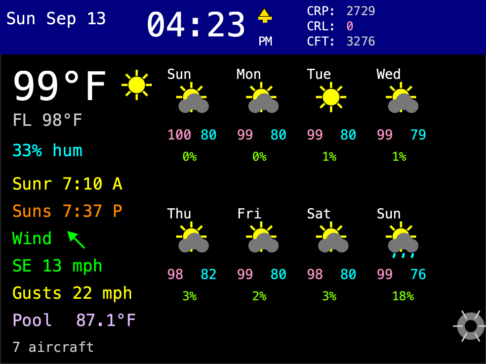
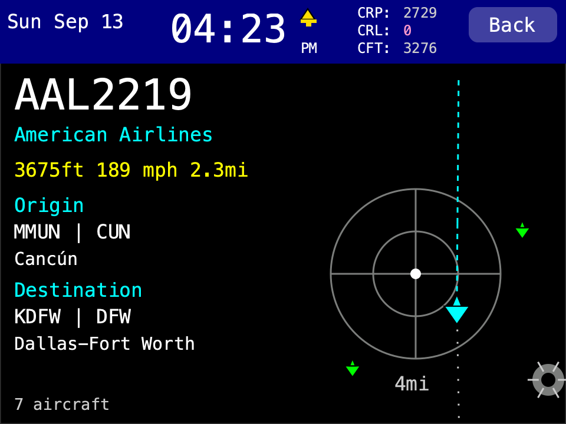
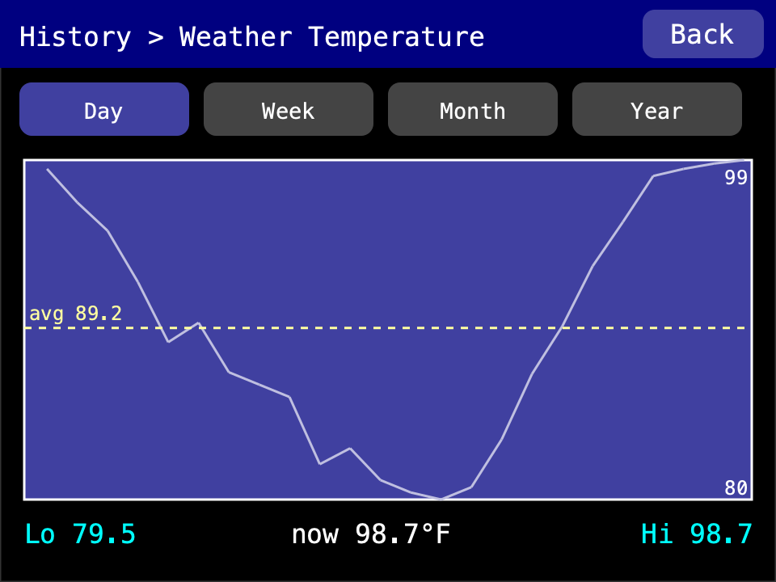

<!-- Tri-fold Letter landscape, printed duplex (flip on long edge).
     Each side is three panels listed left-to-right as printed; <!-- PANEL -->
     splits them. OUTSIDE = [inside flap | back cover | front cover] — the
     rightmost panel is the cover; the leftmost tucks inside when folded.
     INSIDE = the three-panel spread read left to right. -->

<!-- SIDE:OUTSIDE -->

<!-- inside flap: the welcome panel, first thing seen when opened -->
## ✨ What It Shows

- **Alarms** — up to 6 weekday-scheduled alarms with an LED + sound alert.
- **Clock & date** — always on top.
- **Firmware updates** — checks daily over WiFi, or update manually.
- **Flight recall** — tap the aircraft count for the last flight's details.
- **Flights overhead** *(optional — on)* — a mini radar of live aircraft:
  callsign, route, altitude, speed, distance, airline logo, ground track.
- **Pool temperature** *(optional — off)* — current water temperature and
  history graphs, with a Govee pool thermometer.
- **Settings** — every option is configurable on-screen.
- **Sleep mode** — sleeps overnight, wakes on touch.
- **Startup chime** — rising melody + LED sweep on power-on (silent when
  waking from sleep); also plays after a firmware update.
- **Weather** — temperature, feels-like, humidity, sunrise/sunset, wind with
  gusts, an 8-day forecast, and temperature history graphs.

## 💨 Wind Tiers

| Color | Tier | Sustained | Gusts |
|---|---|---|---|
| Green | calm | under 15 mph | under 20 mph |
| Yellow | gusty | 15–24 mph | 20–34 mph |
| Orange | strong | 25–30 mph | 35–45 mph |
| Red | advisory | 31+ mph | 46+ mph |

Red raises a **Wind Advisory** popup — waking from sleep if needed. **Dismiss**
silences it for 24 h; **Snooze** re-arms in 6 h, up to 3×. Tap the wind rows on
the dashboard for this table and wind alert settings.

<!-- PANEL -->

<!-- back cover -->
## 🔄 Resetting (Settings → Reset)

Every option asks you to confirm and says exactly what it clears:

- **Restart** — reboots only; clears nothing.
- **Graph Data** — clears pool and weather temperature history.
- **Settings** — clears settings and credentials (keeps touch calibration).
- **Network** — clears WiFi credentials and IP settings (static IP, hostname);
  everything else is kept.
- **Factory Reset** — clears *everything*: settings, credentials, files,
  history, and touch calibration. The next boot recalibrates touch and asks
  for WiFi again.
- **Cancel** — backs out without changing anything.

⚠ **Factory Reset erases any pre-loaded
airline logos** — restoring logos requires regenerating and reloading them
from a development computer.

## 🛠 Troubleshooting

- **Taps land in the wrong spot** — press and hold anywhere on the screen for
  **10 seconds** to recalibrate.
- **Wrong weather or no flights nearby** — fix your location under
  **Settings → Location**.
- **A flight's route or track looks wrong** — route and ground-track data
  come from public flight-data feeds that may not have the
  latest data, so they can be missing, outdated, or inaccurate.
- **Can't connect to WiFi / network not listed** — the device supports
  **2.4 GHz WiFi only** (not 5 GHz), and a scan takes a few seconds to list
  networks — longer the first time after boot.

<!-- PANEL -->

<!-- front cover -->

<strong>Live flight tracker &amp; weather station</strong> for <strong>Cheap
Yellow Display (CYD)</strong> boards:

<ul>
<li><strong>2.8" 2432S028R</strong></li>
<li><strong>4" E32R40T</strong></li>
</ul>

Once it's set up it runs on your WiFi — no computer needed.

{{VERSION}}

<em><a href="https://github.com/improving-minnesota/cyd-horizon">github.com/improving-minnesota/cyd-horizon</a></em>

<!-- SIDE:INSIDE -->

<!-- inside spread, panel 1: setup -->
## 🚀 Getting Started

1. **Plug it in.** On a brand-new device (or after a Factory Reset) it first
   asks you to tap a few crosshairs to calibrate the touchscreen — this is
   skipped if calibration is already saved.
2. **Enter WiFi.** Type your network name and password with the on-screen
   keyboard. The device supports **2.4 GHz WiFi only** — 5 GHz networks won't
   work. (Change it later under **Settings → Network**.)
3. Done — the dashboard appears and starts loading weather and flights.

## 📍 Set Your Location

Weather and flights need to know where you are. On first boot the device
guesses your location from your internet connection — check that it's right:

Open **Settings → Location**, then use whichever is easiest:

- **Search Address** — type your city or address and pick the match.
- **Set** — type your latitude and longitude directly.
- **Find by IP** — guess again from your connection.

## 🔑 OpenSky Account (Recommended)

Flights work out of the box, but a free OpenSky account raises your daily
limit and removes the yellow "anonymous" warning.

1. Create a free account at **opensky-network.org**.
2. Go to **My OpenSky → Account** and create an **API client** — that
   downloads a file containing your **client ID** and **client secret**.
3. On the device: open **Settings → Flight Tracker**, page right to the
   **OpenSky Credentials** screen, and enter both.

The three small readouts in the header — **CRP**, **CRL**, **CFT** — show
your remaining daily OpenSky credits (tap them for detail). Grey is healthy,
yellow is low, pink is nearly out. Credits reset daily.

## 🌡️ Govee Pool Thermometer (Optional)

Only if you own a Govee pool thermometer:

1. Create a free developer account at **developer.govee.com** and generate an
   **API key**.
2. On the device: open **Settings → Pool Temp**, turn it **on**, enter the
   key, tap **Fetch Devices**, and pick your thermometer.

<!-- PANEL -->

<!-- inside spread, panel 2: daily use -->
## 👆 Using the Dashboard

The main screen isn't just a display — several spots are **buttons you can
tap**:

- **Cog (bottom-right)** — open settings.
- **Weather temperature (top-left)** — weather history graph.
- **Pool reading** — pool temperature history graph.
- **Aircraft count (bottom-left)** — details of the last overhead flight.
- **CRP / CRL / CFT (header)** — OpenSky credits detail.
- **Clock/date (header)** — open the alarm editor.
- Any settings or graph screen returns to the dashboard after 2 minutes
  untouched.

## ⏰ Alarms

Up to 6, each with its own weekdays and a **Notify** pattern. Leave all
weekdays off for a one-time alarm. Set the
time with the
**▼ / ▲** arrow buttons — hour on the
left, minute on the right (the hour rolls through AM/PM) — or tap the time
to type it. A bell icon sits beside the clock while any alarm is on. **Delete** asks
for confirmation before removing an alarm.

When one fires: **Dismiss** stops it for today; **Snooze** refires in 5 min
(up to 3 snoozes, then it dismisses for the day). Alarms fire on time even
during Sleep Mode — the device wakes itself at the alarm time — and a
snoozed or missed alarm still fires after a power loss.

🔊 Sound requires an <strong>external speaker</strong> plugged into the board's small
JST port — the display has no built-in speaker, so without one alarms flash
the LED only. Loudness comes from <strong>Notify Volume</strong> under
Settings → General; it applies to alarms, the callsign alert, and the boot
chime.

<!-- PANEL -->

<!-- inside spread, panel 3: reference -->
## ⚙️ Settings at a Glance

Defaults shown in parentheses.

- **About** — version, author, and firmware update status / install.
- **Calibrate Touch** — rerun touch calibration.
- **Flight Tracker** — enabled (on); radius (3.5 mi/km/nm); ceiling (15,000
  ft/m); poll interval (30 s); timer bar (off); home airport (none); watch
  callsign (none; matches any part of a callsign, \* = every flight) and its
  notify pattern (Radar); LED blink (on); Show IATA (on); OpenSky credentials.
- **General** — theme color (tap a swatch); auto-update (on); Notify Volume
  (1–10, default 10); units (Imperial/Metric/Aviation — also °F or °C); clock
  (12 or 24-hour). Page 2 holds **Wind Alert** (on) and its **Wind Notify**
  sound (Breeze); both are also on the wind tiers page.
- **Location** — your coordinates (auto-guessed on first boot).
- **Network** — WiFi network (it shows *Scanning* while it searches — a few
  seconds, and longer the first time after boot); DHCP or static IP; device
  hostname.
- **Pool Temp** — (off) enable, enter the API key, pick your thermometer.
  While off, no data is collected.
- **Reset** — see the back cover.
- **Sleep Mode** — enabled (on); sleeps 10:00 PM – 8:00 AM; a touch wakes it
  for 5 minutes.

## 💡 LED & Border Colors

- **Red border / LED** — something needs attention: no WiFi, bad OpenSky
  credentials, exhausted credits, or missing weather/pool data.
- **Yellow** — OpenSky is running anonymously; flights still work.
- **Flight blinks** — blue for any overhead flight; red departing, green
  arriving, yellow both ends at your home airport. A watched callsign plays
  its **Callsign Notify** pattern instead, regardless of the blink setting.

## 📦 Firmware Updates

**Auto-Update** (on) checks once a day over WiFi and installs new releases;
**Settings → About → Install** updates manually. A failed update rolls back.
